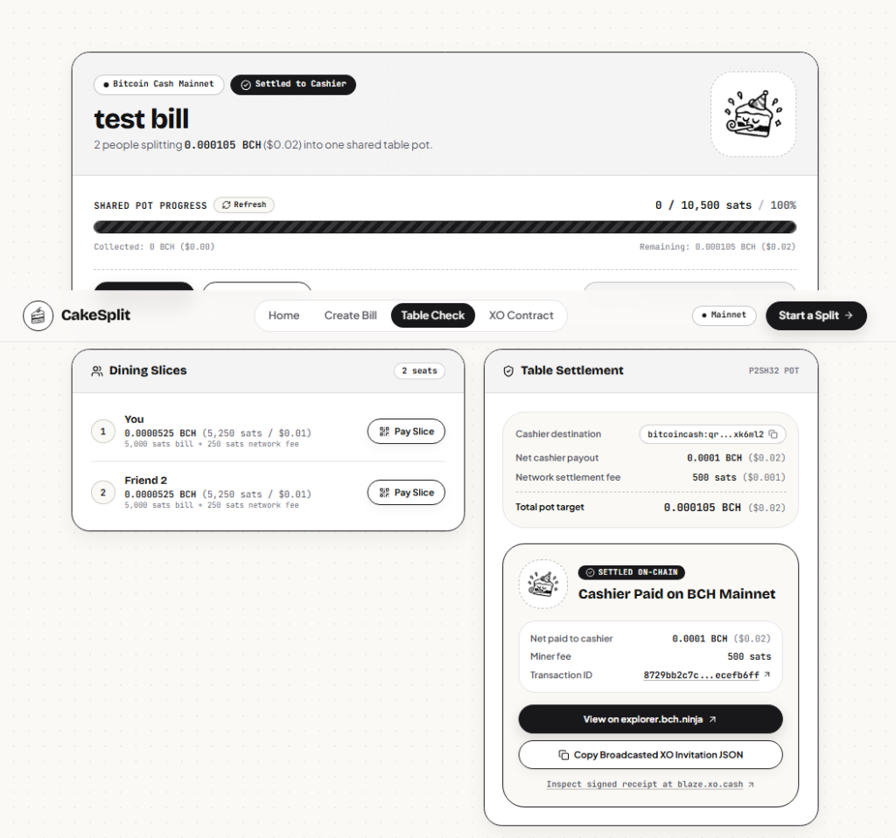
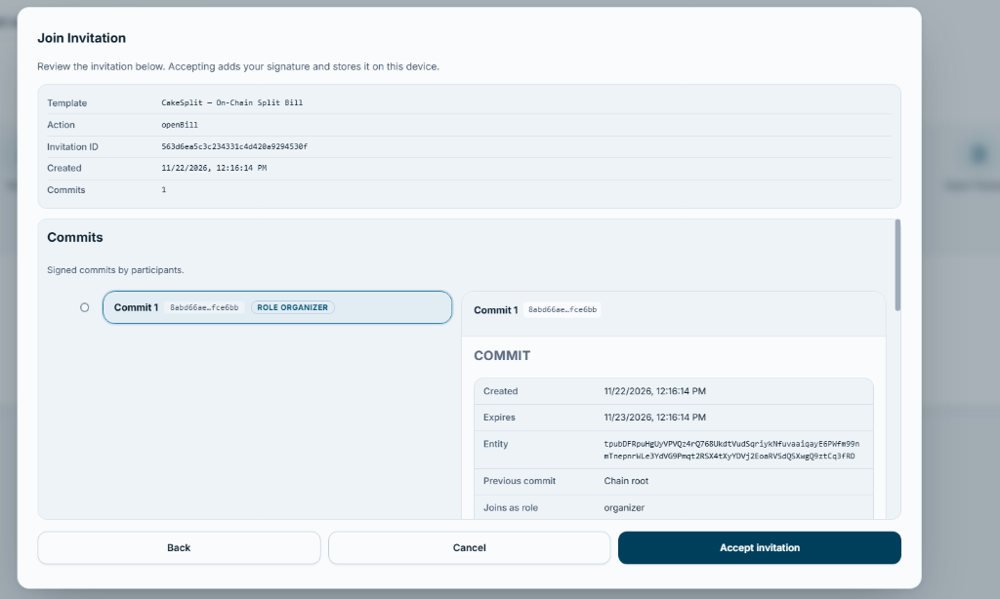

<div align="center">


# CakeSplit

**Split the table. Pay the cashier in one tap.**

Trustless, non-custodial group bill splitting built natively on **Bitcoin Cash Mainnet** with an **XO Template** (`@xo-cash`) for **BCH BLAZE 2026**.

<p>
  <a href="https://cakesplit-bch.vercel.app">
    
  </a>
  <a href="https://blaze.xo.cash/">
    
  </a>
  
  
  
</p>

<p>
  <a href="https://cakesplit-bch.vercel.app"><strong>Open Live App</strong></a>
  &nbsp;&middot;&nbsp;
  <a href="https://docs.google.com/presentation/d/1MWgxqhW43VwhE9tCDykVvCvQUX3ljzvHgSwMqDwQqhs/edit?usp=sharing"><strong>Widget Factory Slides</strong></a>
  &nbsp;&middot;&nbsp;
  <a href="https://cakesplit-bch.vercel.app/xo"><strong>XO Contract Inspector</strong></a>
  &nbsp;&middot;&nbsp;
  <a href="https://blaze.xo.cash/"><strong>Inspect on blaze.xo.cash</strong></a>
</p>

</div>

---

## What Is CakeSplit?

When friends eat out or share a group bill, someone always has to front the entire check and chase repayments—or everyone sends money to one person's wallet and hopes they pay the cashier.

**CakeSplit removes the trusted collector.** Every table check deterministically compiles a unique **113-byte P2SH32 Bill Pot Covenant** (`bitcoincash:p...`) whose destination is cryptographically locked to the cashier's address. There are **no accounts, no backend database, and zero contract deployment fees**.

<table>
  <tr>
    <td align="center" width="33%">
      <br />
      <strong>1. Slice the Table Check</strong><br />
      <sub>Set the total in <strong>USD</strong> (live rate) or <strong>BCH</strong>, enter the cashier address, and split equally or by custom slices.</sub>
    </td>
    <td align="center" width="33%">
      <br />
      <strong>2. Everyone Chips In</strong><br />
      <sub>Share one compact link or camera QR. Friends pay their slice from Cashonize, Paytaca, or Selene with live 0-conf tracking.</sub>
    </td>
    <td align="center" width="33%">
      <br />
      <strong>3. One Tap Pays the Cashier</strong><br />
      <sub>Once the pot hits 100%, anyone at the table settles the full bill straight to the cashier with zero signatures.</sub>
    </td>
  </tr>
</table>

---

## BCH BLAZE 2026 Submission Overview

- **Live Mainnet Web App:** https://cakesplit-bch.vercel.app
- **Widget Factory Google Slides:** https://docs.google.com/presentation/d/1MWgxqhW43VwhE9tCDykVvCvQUX3ljzvHgSwMqDwQqhs/edit?usp=sharing
- **Public Repository:** https://github.com/Rezacrown/cakesplit-bch-submission
- **XO Template ID:** `c52aac6dcb3a27a8d2f915f1c20fbf806548041e2ea88f6abc6fcca9cd8f4755`
- **Build with XO Developer Feedback:** [`docs/XO_FEEDBACK.md`](docs/XO_FEEDBACK.md)
- **EMBER2026 CashTokens Address:** `bitcoincash:zr4jg99w7eeupyd9hch370t3ffkd8kmmfs9y4g5aqe`
- **Tracks & Bounty:** Build with XO (General Protocols), Mainnet Track, Media Track, Community Choice (`EMBER2026`)

---

## Verified BCH Mainnet Execution Proof

CakeSplit has executed a real, end-to-end multi-participant split bill and permissionless 0-signature P2SH32 covenant settlement live on **Bitcoin Cash Mainnet**:

| Lifecycle Step | Amount | Mainnet Transaction ID | Explorer |
| :--- | :--- | :--- | :--- |
| **1. Pay Slice #1** (Cashonize → P2SH32 Bill Pot) | `5,250 sats` | `d84e42f5c4005432216b5164b15c5b4c9d1aab3727b3589cf799b3f7fe7ef4e3` | [bch.ninja](https://explorer.bch.ninja/tx/d84e42f5c4005432216b5164b15c5b4c9d1aab3727b3589cf799b3f7fe7ef4e3) · [Blockchair](https://blockchair.com/bitcoin-cash/transaction/d84e42f5c4005432216b5164b15c5b4c9d1aab3727b3589cf799b3f7fe7ef4e3) |
| **2. Pay Slice #2** (Cashonize → P2SH32 Bill Pot) | `5,250 sats` | `e19026a0dd42b11e5e8e070bf09df8c13ce3544f110afd6a8c226fe2b8c8f1b8` | [bch.ninja](https://explorer.bch.ninja/tx/e19026a0dd42b11e5e8e070bf09df8c13ce3544f110afd6a8c226fe2b8c8f1b8) · [Blockchair](https://blockchair.com/bitcoin-cash/transaction/e19026a0dd42b11e5e8e070bf09df8c13ce3544f110afd6a8c226fe2b8c8f1b8) |
| **3. `settleBill`** (Permissionless 0-sig sweep → Cashier) | `10,000 sats` net (`500 sats` fee) | **`8729bb2c7cf880a7496e662233aa21612dabafefe20772f82c8ae39aecefb6ff`** | [bch.ninja](https://explorer.bch.ninja/tx/8729bb2c7cf880a7496e662233aa21612dabafefe20772f82c8ae39aecefb6ff) · [Selene](https://explorer.selene.cash/tx/8729bb2c7cf880a7496e662233aa21612dabafefe20772f82c8ae39aecefb6ff?network=mainnet) |

<p align="center">
  
</p>

---

## Try CakeSplit on BCH Mainnet in 60 Seconds (Judge Guide)

You can execute a real, recoverable **BCH Mainnet** covenant lifecycle using minimal funds (`~4,000 sats` / `~$0.01 USD`) where the net payout returns straight to your own wallet:

1. Open **[https://cakesplit-bch.vercel.app/create](https://cakesplit-bch.vercel.app/create)**.
2. Enter a bill title, paste **your own `bitcoincash:q...` address** as the Cashier Address, switch unit to `BCH` (or enter `$0.02` in `USD`), and set a small total (e.g., `0.000035` BCH / `3,500 sats` across 2 seats).
3. Click **Create Table Check** — CakeSplit compiles the deterministic P2SH32 Bill Pot address (`bitcoincash:p...`) and opens `/bill?d=...`.
4. Click **Pay Slice** on each seat and scan inside **Cashonize**, **Paytaca**, or **Selene** (*Send -> Scan QR*, or copy the pot address). Incoming 0-conf deposits appear automatically within ~4 seconds via Fulcrum WSS.
5. Once the progress bar reaches **100%**, click **Pay Cashier Now** — the permissionless `settleBill` transaction sweeps all pot UTXOs directly to your cashier address with **0 signatures**, displays the `explorer.bch.ninja` link, and lets you copy the **Schnorr-signed broadcasted XO Invitation JSON**.
6. *(Optional pre-full test)* If you only fund 1 slice (`< 100%`), click **Cancel & Refund Table** to test the organizer-only `cancelBill` escape hatch—which is cryptographically blocked by the BCH 2026 VM once the pot reaches 100%.

---

## Smart Contract Architecture (Bill Pot XO Covenant)

Defined in [`src/lib/xo/cakesplit-template.ts`](src/lib/xo/cakesplit-template.ts) and verified byte-for-byte against `@xo-cash/utils` CashASM in [`src/lib/bch/cakesplit-contract.ts`](src/lib/bch/cakesplit-contract.ts). Zero timelocks (`CLTV`/`CSV`), compact `113 bytes` P2SH32 redeem bytecode, and mandatory pre-flight **BCH 2026 VM (`@bitauth/libauth`)** verification before every broadcast.

| Parameter | Role in Redeem Script |
| :--- | :--- |
| `billNonce` | Unique 8-byte salt giving every table check its own P2SH32 address |
| `merchantLockingScript` | Exact locking bytecode of the cashier / merchant destination |
| `merchantPayoutSatoshis` | Minimum net satoshis guaranteed to the cashier upon settlement |
| `settlementFeeSatoshis` | Fixed `500 sats` reserve distributed across slices so settlement needs zero extra wallet inputs |
| `organizerPublicKey` | Compressed 33-byte secp256k1 key allowed to cancel **only before full** |

### Covenant Actions (1 Start + 3 Follow-Up Actions)

| Action | Role | Spend Rule Enforced by BCH 2026 VM |
| :--- | :--- | :--- |
| **`openBill`** | `organizer` | Start action: opens the P2SH32 Bill Pot output and generates the shareable check & XO Invitation. |
| **`chipIn`** | `contributor` | **Branch `0` (Permissionless):** `output[0].lockingBytecode == activeInput.utxoBytecode` AND `output[0].value > activeInput.utxoValue`. Funds can only grow inside the exact same covenant. |
| **`settleBill`** | `settler` | **Branch `1` (Permissionless, 0 Signatures):** `output[0].lockingBytecode == merchantLockingScript` AND `output[0].value >= merchantPayoutSatoshis`. Sweeps 1 or N UTXOs in one transaction. |
| **`cancelBill`** | `organizer` | **Branch `2` (Pre-Full Escape Hatch):** `activeInput.utxoValue < merchantPayoutSatoshis + settlementFeeSatoshis` AND valid Schnorr signature from `organizerPublicKey`. Rejected by the VM once full (anti-rug). |

---

## Build with XO — Inspection & Reproduction (`blaze.xo.cash`)

Reproducible XO Template and Schnorr-signed Invitation artifacts live in [`artifacts/xo/`](artifacts/xo/README.md) and can also be generated live for any bill inside the app at **`/xo`**.

1. Open **[https://blaze.xo.cash/](https://blaze.xo.cash/)**.
2. Click **Import Template** and paste [`artifacts/xo/cakesplit-template.json`](artifacts/xo/cakesplit-template.json).
3. Click **Join Invitation** and paste any of the signed invitations (including the real broadcasted Mainnet settlement):
   - **[`artifacts/xo/mainnet-settleBill-invitation.json`](artifacts/xo/mainnet-settleBill-invitation.json)** *(Live BCH Mainnet broadcasted `settleBill` receipt — `txid 8729bb2c7c...ecefb6ff`)*
   - [`artifacts/xo/invitation-openBill.json`](artifacts/xo/invitation-openBill.json)
   - [`artifacts/xo/invitation-chipIn.json`](artifacts/xo/invitation-chipIn.json)
   - [`artifacts/xo/invitation-settleBill.json`](artifacts/xo/invitation-settleBill.json)
   - [`artifacts/xo/invitation-cancelBill.json`](artifacts/xo/invitation-cancelBill.json)

<div align="center">
  
  <br />
  <sub>CakeSplit XO Template and Schnorr-signed <code>openBill</code> invitation inspected directly inside <code>blaze.xo.cash</code>.</sub>
</div>

Re-generate all XO artifacts and verify all 39 tests (including BCH 2026 VM attack vectors, live Mainnet XO signature verification, history classification, and CashASM parity) locally:

```bash
pnpm xo:artifacts
pnpm test
```

---

## Tech Stack & Architecture

- **Frontend:** Next.js `16.4.6` (App Router + Turbopack), React `19.3`, Tailwind CSS v4, `shadcn/ui` (monochrome rubber-hose ink cartoon design), TanStack Query v5, Zod v4, Zustand v5
- **Bitcoin Cash & XO Stack:** `@xo-cash/engine@0.1.1-next.18230317763`, `@xo-cash/crypto`, `@xo-cash/types`, `@xo-cash/templates`, `@xo-cash/utils`, `@bitauth/libauth@3.1.0-next.8`, `@electrum-cash/network@4.4.8`
- **Serverless State:** Compact v2 binary URL codec (~3x shorter than raw JSON for effortless phone-camera QR scanning) + live Mainnet Fulcrum WSS polling (`bch.imaginary.cash`, `electrum.imaginary.cash`, `cashnode.bch.ninja`, `fulcrum.greyh.at`)

```text
src/
├── app/                  # Thin Next.js routes (/, /create, /bill, /xo)
├── components/
│   ├── layout/           # AppShell, BlazeTopBanner, SiteHeader, SiteFooter
│   └── ui/               # shadcn/ui primitives
├── hooks/                # Shared React Query hooks (useBchPrice)
├── lib/
│   ├── bch/              # P2SH32 compiler, tx builders, compact v2 URL codec, Fulcrum WSS, QR, keys
│   ├── config/           # Typed environment configuration (env.ts)
│   ├── schemas/          # Zod schemas
│   └── xo/               # CakeSplit XO Template & Schnorr-signed Invitation generator/verifier
├── modules/              # 5-layer feature modules (landing, create-bill, bill-room, xo-inspector)
├── services/client/      # Live Fulcrum Mainnet & Coinbase/CoinGecko BCH/USD spot rate workflows
└── store/                # Zustand client state
```

---

## Environment Configuration (`.env`)

All deployment-specific URLs, banner links, and BCH Mainnet endpoints live in [`src/lib/config/env.ts`](src/lib/config/env.ts) and [`.env.example`](.env.example). Switching to a custom domain or updating your Widget Factory Slides link on Vercel requires **zero code edits**.

```bash
cp .env.example .env.local
```

| Variable | Purpose | Default |
| :--- | :--- | :--- |
| `NEXT_PUBLIC_APP_URL` | Canonical public URL for metadata (in the browser, `/bill` share links auto-adapt to `window.location.origin`) | `https://cakesplit-bch.vercel.app` |
| `NEXT_PUBLIC_APP_NAME` | Application brand name | `CakeSplit` |
| `NEXT_PUBLIC_GITHUB_REPO_URL` | Public repository URL shown in banner and footer | `https://github.com/Rezacrown/cakesplit-bch-submission` |
| `NEXT_PUBLIC_SLIDES_URL` | Public Widget Factory Google Slides share URL (switches top banner link to **Slides** automatically when set) | *(empty — falls back to `/#reel`)* |
| `NEXT_PUBLIC_EMBER_ADDRESS` | CashTokens `bitcoincash:z...` address for `EMBER2026` voting | `bitcoincash:zr4jg99w7eeupyd9hch370t3ffkd8kmmfs9y4g5aqe` |
| `NEXT_PUBLIC_XO_DEBUG_TOOL_URL` | XO Debug Tool base URL | `https://blaze.xo.cash/` |
| `NEXT_PUBLIC_ELECTRUM_MAINNET_SERVERS` | Comma-separated Fulcrum WSS endpoints (`host:port`) | `bch.imaginary.cash:50004,...` |
| `NEXT_PUBLIC_EXPLORER_MAINNET_URL` | Mainnet block explorer base URL | `https://explorer.bch.ninja` |
| `NEXT_PUBLIC_FALLBACK_BCH_USD_PRICE` | Offline fallback BCH/USD rate if spot APIs are unreachable | `200` |

---

## Local Development & Verification

```bash
pnpm install
pnpm dev

# Full verification suite
pnpm typecheck
pnpm lint
pnpm test
pnpm build
```

---

## License

MIT
